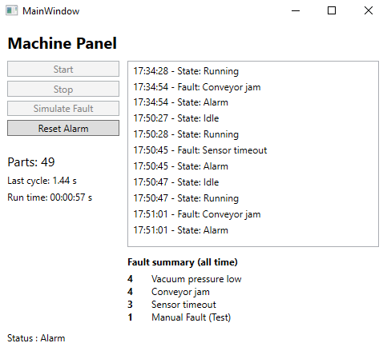

# MachinePanel

A WPF desktop app that simulates a semiconductor-style equipment control panel: start/stop control, a state machine with alarms, a live event log, and fault history stored in a SQL database.



> The machine is simulated in software. No real hardware is required.

## Features

- **Machine state machine:** Idle, Running, Stopped and Alarm, with buttons enabled only when an action is allowed in the current state
- **Simulated production:** each part takes a random 0.8–1.5 s cycle time; the panel shows the last cycle time
- **Run time:** total time spent running (stopped and alarm time are excluded)
- **Random faults:** 5% chance per part (conveyor jam, sensor timeout, vacuum pressure low), plus a manual fault button for testing
- **Event log:** every state change and fault is shown with a timestamp
- **Persistent history:** events are saved to a SQLite database and survive restarts
- **Fault summary:** shows how often each fault has occurred, queried from the database

## Tech stack

- C# / .NET 10
- WPF
- MVVM with [CommunityToolkit.Mvvm](https://www.nuget.org/packages/CommunityToolkit.Mvvm)
- SQLite with [Microsoft.Data.Sqlite](https://www.nuget.org/packages/Microsoft.Data.Sqlite), using parameterized queries

## Architecture

The app follows MVVM, with the machine logic kept independent of the UI.

| File | Role |
|---|---|
| `Machine.cs` | **Model.** Machine state, rules, part counting and fault simulation. Plain C# with no WPF dependency. |
| `MachineState.cs` | The machine's possible states |
| `MainViewModel.cs` | **ViewModel.** Exposes state, commands and the log to the UI, and drives the machine with a timer |
| `MainWindow.xaml` | **View.** Layout and data bindings only; no logic in code-behind |
| `EventStore.cs` | Saves events to SQLite and reads the fault summary |
| `EventTypes.cs` | Shared constants for event types |
| `FaultSummary.cs` | Record holding one row of the fault summary |

Because the machine is a separate class, the simulated machine can later be replaced with a real equipment connection (for example SECS/GEM or a PLC) without changing the UI.

## Getting started

### Option 1 : Download the release (Windows x64 only)
1. Download the latest release from the [Releases page](https://github.com/kelvinkosumic/MachinePanel/releases)
2. Run `MachinePanel.exe`.

Requires Windows x64. No .NET installation is needed because the runtime is included.

> The app saves its database next to the `.exe`, so don't extract it into a protected folder like `Program Files`.
>
> Windows may show a SmartScreen warning because the app isn't code-signed. Click **More info**, then **Run anyway**.

### Option 2 : Build from source

Requirements:

- Windows
- Visual Studio 2026 with the **.NET desktop development** workload

Steps:

1. Clone the repository.
2. Open the solution in Visual Studio.
3. Press **F5** to build and run. NuGet packages are restored automatically.

## Database

The app creates `machine.db` next to the executable on first run. Events are stored in the `MachineEvents` table:

| Column | Description |
|---|---|
| `Id` | Auto-numbered row ID |
| `LoggedAt` | Timestamp (`yyyy-MM-dd HH:mm:ss`) |
| `EventType` | `State` or `Fault` |
| `Message` | New state, or fault reason |

Example query (fault counts, most frequent first):

```sql
SELECT Message, COUNT(*) AS Times
FROM MachineEvents
WHERE EventType = 'Fault'
GROUP BY Message
ORDER BY Times DESC;
```

## Roadmap

- [ ] SECS/GEM communication with a simulated host
- [ ] PLC connectivity

## Author

Build by Kelvin Goh Chor Cuang as a portfolio project for semiconductor equipment automation.

[LinkedIn](www.linkedin.com/in/kelvin-goh-chor-cuang) · [GitHub](https://github.com/kelvinkosumic)